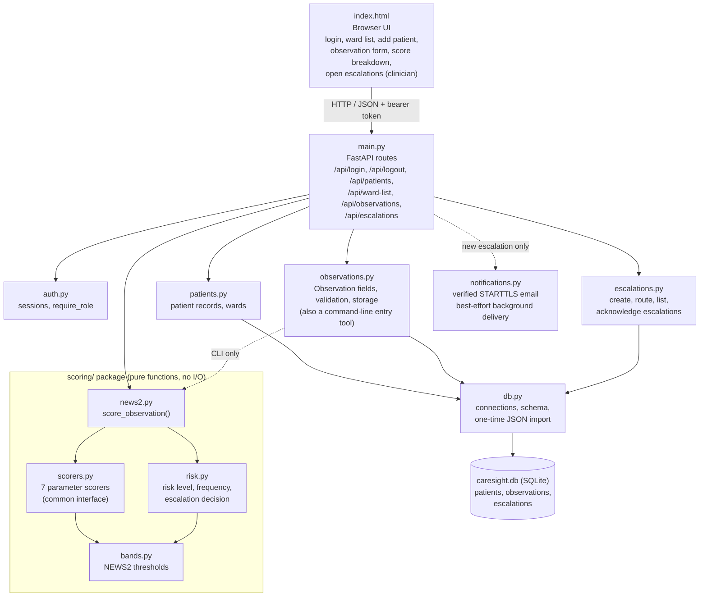

# Architectural Design (updated for P4)

## Components

## Responsibilities

| Component | Responsibility | User stories |
| :--- | :--- | :--- |
| `index.html` | Presents sign-in, the ward list and add-patient form, the observation form and score breakdown, an escalation alert on save, and the open-escalations list for clinicians; highlights invalid fields and parameters that scored 3 | US-01, US-02, US-03, US-06, US-07 |
| `auth.py` | Sessions (random tokens stored as hashes, 8-hour expiry), password hashing and the shared `require_role` dependency | US-01 |
| `db.py` | Opens SQLite connections, creates the schema, wraps work in transactions, imports old JSON data once | US-02, US-03, US-07, US-08 |
| `patients.py` | Patient records (ID, name, ward, bed), validation, duplicate ID and occupied-bed checks on create and update, ward list | US-02 |
| `escalations.py` | Turns a scoring result that requires escalation into an Open escalation, routed by risk level and tagged with the ward; lists by risk level then oldest first; acknowledges with a response note | US-07, US-08 |
| `notifications.py` | Reads email environment settings at runtime and sends an escalation summary through Gmail STARTTLS; never sends inline with the observation response | US-07 |
| `main.py` | HTTP routes protected by the shared `auth.py` session and role dependencies, turns validation errors into `422` responses that name the bad fields | US-01, US-02, US-03, US-07 |
| `observations.py` | Defines the seven fields and their valid ranges, validates a whole observation, saves and loads observations safely (atomic write, corrupt-file backup) | US-03 |
| `scoring/scorers.py` | One scorer class per parameter, all implementing `ParameterScorer.score(value)` | US-04 |
| `scoring/bands.py` | The only place NEWS2 thresholds are written | US-04, US-05 |
| `scoring/risk.py` | Maps total score and "any single 3" to risk level, observation frequency, escalation decision and recommended response | US-05, US-07 (input) |
| `scoring/news2.py` | Runs every scorer, adds the sub-scores, calls the risk rules and calculates the next-observation-due time | US-04, US-05, US-06 |

## Request flow: recording an observation

1. The nurse submits the form; the browser sends `POST /api/observations`.
2. `auth.require_role` verifies the bearer session and Nurse/Clinician role. `main.py` derives the recorder from that session and checks that the patient exists, then calls `validate_observation_values()`. If any field is missing or out of range the response is `422` with a per-field message and **nothing is saved**.
3. Otherwise the observation is stamped with the time and saved by `observations.save_observation()`.
4. `scoring.score_observation()` returns sub-scores, total, risk level, frequency, next-due time and escalation flag.
5. `escalations.create_escalation_if_required()` reads the escalation decision from the score. If it is required, an Open escalation is saved with patient, score, risk level and required response.
6. Only after an escalation is saved, FastAPI schedules `notifications.send_escalation_notification()` as an in-process background task. The sender reads environment configuration at delivery time and uses verified STARTTLS; invalid configuration or delivery failure does not undo the saved records.
7. The response returns the saved observation, the score and the escalation (or `null`); the UI renders the breakdown table and an alert if an escalation was raised.
8. Clinicians see open escalations through `GET /api/escalations` (Clinician role only), sorted by risk level, then oldest first, optionally for one ward. Listing and history requests never schedule email.
9. A clinician acknowledges one with `POST /api/escalations/{id}/acknowledge` and a response note. The status changes from Open to Acknowledged in a single write transaction, so a second acknowledgement gets `409`.

## Main design decisions

| Decision | Reason |
| :--- | :--- |
| **Scoring package has no I/O and no dependency on FastAPI or storage** | Scoring is the safety-critical part (NFR-01). Pure functions are easy to test exhaustively and can be reused by the API, the CLI and future escalation code. |
| **Thresholds in `bands.py` only** | NFR-04 and the P1 change-risk mitigation: a threshold change (for example SpO2 Scale 2) touches one file. |
| **One scorer class per parameter behind a common interface** | Adding or changing a parameter does not affect the others; each can be boundary-tested on its own. |
| **Scoring is separate from escalation routing** | `risk.py` only *decides* whether escalation is required. Creating and listing escalations is done by the separate `escalations.py` module, which only reads the scoring result, so escalation code never needs to change when scoring changes (NFR-04). |
| **Scores are calculated on read, not stored with the observation** | The stored data stays the raw measurements; if a band is corrected, history is re-scored correctly. |
| **FastAPI with a single static page** | Meets the Chrome/Firefox requirement (NFR-05) with the least tooling. Easy for all four members to run locally. |
| **SQLite through the standard library** | Gives transactions, unique constraints (one patient per bed) and safe concurrent writes with no server to install, so every member can run it. The modules kept their public functions, so routes and the scoring code did not change. Moving to PostgreSQL later only changes `db.py` and the SQL in the three storage modules. |
| **Routing is a table keyed by the risk level from `risk.py`** | Scoring still only decides *whether* to escalate; `escalations.ROUTES` decides *who*. Changing a team never touches scoring. |
| **Acknowledge is a conditional update (`WHERE status = 'Open'`)** | Two clinicians cannot both acknowledge the same escalation, and the first response note is never overwritten. |
| **One escalation per qualifying observation** | Matches the US-07 criterion ("when it is saved, an Open escalation is created") and lets each escalation be acknowledged on its own in US-08. |
| **Salted PBKDF2 password hashes** | NFR-06 forbids storing passwords in plain text. |

## Known gaps (planned for the next iteration)

- Sessions are in memory and require a single server worker. Restarting clears sessions. See [AUTH.md](AUTH.md).
- Staff are not assigned to wards yet, so the ward list is filtered by choice rather than by the nurse's own ward (moves to US-12).
- Acknowledged is the final status; there is no separate Resolved step yet.
- Email delivery is disabled by default and best-effort only: in-process background tasks are not durable and are not automatically retried. See the US-07 instructions in `README.md`.
- Staff provisioning is planned under US-12. Patient self-registration has been removed.
