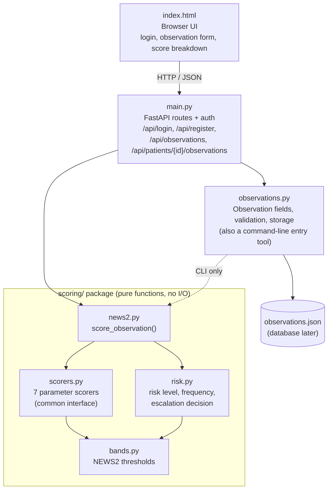

# Initial Architectural Design (P2.2)

## Components

## Responsibilities

| Component | Responsibility | User stories |
| :--- | :--- | :--- |
| `index.html` | Presents sign-in, the observation form and the score breakdown; highlights invalid fields and parameters that scored 3 | US-01, US-03, US-06 |
| `main.py` | HTTP routes, password hashing and verification, turns validation errors into `422` responses that name the bad fields | US-01, US-03 |
| `observations.py` | Defines the seven fields and their valid ranges, validates a whole observation, saves and loads observations safely (atomic write, corrupt-file backup) | US-03 |
| `scoring/scorers.py` | One scorer class per parameter, all implementing `ParameterScorer.score(value)` | US-04 |
| `scoring/bands.py` | The only place NEWS2 thresholds are written | US-04, US-05 |
| `scoring/risk.py` | Maps total score and "any single 3" to risk level, observation frequency, escalation decision and recommended response | US-05, (US-07 input) |
| `scoring/news2.py` | Runs every scorer, adds the sub-scores, calls the risk rules and calculates the next-observation-due time | US-04, US-05, US-06 |

## Request flow: recording an observation

1. The nurse submits the form; the browser sends `POST /api/observations`.
2. `main.py` checks patient ID and recorder, then calls `validate_observation_values()`. If any field is missing or out of range the response is `422` with a per-field message and **nothing is saved**.
3. Otherwise the observation is stamped with the time and saved by `observations.save_observation()`.
4. `scoring.score_observation()` returns sub-scores, total, risk level, frequency, next-due time and escalation flag.
5. The response returns the saved observation and the score; the UI renders the breakdown table.

## Main design decisions

| Decision | Reason |
| :--- | :--- |
| **Scoring package has no I/O and no dependency on FastAPI or storage** | Scoring is the safety-critical part (NFR-01). Pure functions are easy to test exhaustively and can be reused by the API, the CLI and future escalation code. |
| **Thresholds in `bands.py` only** | NFR-04 and the P1 change-risk mitigation: a threshold change (for example SpO2 Scale 2) touches one file. |
| **One scorer class per parameter behind a common interface** | Adding or changing a parameter does not affect the others; each can be boundary-tested on its own. |
| **Scoring is separate from escalation routing** | `risk.py` only *decides* whether escalation is required. Creating and routing escalations (US-07) will be a separate module that consumes this result, so notification code never needs to change when scoring changes (NFR-04). |
| **Scores are calculated on read, not stored with the observation** | The stored data stays the raw measurements; if a band is corrected, history is re-scored correctly. |
| **FastAPI with a single static page** | Meets the Chrome/Firefox requirement (NFR-05) with the least tooling. Easy for all four members to run locally. |
| **JSON file storage for now, behind `load_observations` / `save_observation`** | Gets the observe-score-explain loop working this iteration. The two functions are the only storage access points, so the planned PostgreSQL move changes one module. |
| **Salted PBKDF2 password hashes** | NFR-06 forbids storing passwords in plain text. |

## Known gaps (planned for the next iteration)

- There are no sessions or tokens yet, so the API does not enforce roles; the UI only shows the observation form to Nurse and Clinician accounts (US-01 is partial).
- Patient IDs are free text; there is no patient record or ward model yet (US-02).
- Registration currently creates a "Patient" role, but P1 states patients do not log in. This needs to be reconciled with the Nurse / Clinician / Administrator roles.
